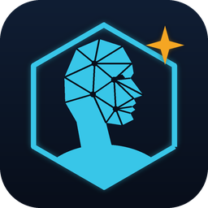

<p align="center"></p>

# SC Character Studio by valkyrie_41

A standalone Windows desktop app for your Star Citizen characters. Keep a library of your character files, preview faces in 3D, and create a new character from a photo.

> **What this app is, and isn't**
> - It's a **standalone desktop app**. It doesn't modify, inject into or run alongside the game, and it doesn't touch your game install.
> - It only **reads** Star Citizen's own head, hair and texture models from **your own local game install** (`Data.p4k`, read-only) to show previews and match faces. None of the game's files are included in this project or in the download.
> - What it produces is a normal **character file (`.chf`)**, the same kind the game saves. You load it in the game's **character customizer** and can keep editing it there.
> - Unofficial fan project. It's not made by or affiliated with Cloud Imperium Games or Roberts Space Industries. Star Citizen® is a trademark of Cloud Imperium Rights LLC.

## Getting started

**You need:** Windows 10 or 11 and Star Citizen installed. Nothing else.

1. **Download:** get **`SC-Character-Studio.exe`** from the [latest release](../../releases/latest).
2. **Put it in its own folder:** for example `Documents\SC Character Studio`.
3. **Run it:** double-click the exe. The app opens in its own window. If Windows says *"Windows protected your PC"*, click **More info → Run anyway**.
4. **Make or import a character:**
   - **Back up all game characters** copies in the characters you've already saved in the game.
   - **Create from photo…** makes a new one from a picture of a face.
5. **Install it:** open the character, choose **LIVE** (or PTU) and click **Install**.
6. **Use it in game:** in Star Citizen's **character customizer**, load the character from your saved characters, adjust it if you like, and save.

Close the window to quit. To update, download the new exe and replace the old one. Your characters are kept.

### Good to know

- **Your data:** the app keeps your library, settings and cache in a **`StudioData`** folder next to the exe. Back up that folder to keep your characters safe.
- **Finding the game:** the app finds Star Citizen on any drive by itself. If it can't, it asks for your `StarCitizen` folder (the one that contains `LIVE`).
- **Privacy:** everything runs on your PC, and your characters and photos are never uploaded. The 3D viewer and photo models download the first time you use them, so you need an internet connection then.
- **Safe installs:** installing never loses a character. If the game already has a different file with the same name, it's backed up to your library first.
- **Very old Windows 10:** the window needs Microsoft Edge WebView2, which is built into Windows 10 and 11. If it's missing, the app tells you where to get it.

## Features

- **Library**
  - Back up every character in your `CustomCharacters` folder with **Back up all game characters**, or import `.chf` files by dropping them on the window.
  - Add a name, notes and a picture. Paste a screenshot with Ctrl+V.
  - Install any character into LIVE or PTU.
- **3D preview**
  - Rebuilds the face from the recipe stored in the `.chf`, using the game's own head models.
  - Shows hair, beard, brows, stubble, skin tone, eye colour, makeup and freckles.
  - Uses the game's own skin detail and makeup masks, with realistic skin, eyes, hair and studio lighting.
  - It's still an approximation: the game's shaders aren't reproduced exactly, so expect small differences in game.
- **Create from photo**
  - Face and hair detection run on your PC (Google MediaPipe), so the photo never leaves it.
  - The face shape is blended from the game's stock heads to match your photo's landmarks.
  - Skin, eye and hair colours snap to the colours the customizer can actually make.
  - **Skin tone strip:** shows the game's own range of skin tones, light to dark, with the photo's estimate marked. Click to go lighter or darker. Very bright or dark photos shift skin tone, and the app warns you when a photo looks like that.
  - **Freckles:** the app looks for small dark spots on the cheeks and nose and sets the customizer's freckle amount and strength. If the face is too small in the photo to see freckles, it uses the game default and tells you. Adjust them with the two sliders.
  - **Makeup (female characters):** the app reads lipstick, eye makeup and blush from the photo and sets each one's colour and amount, using the customizer's own makeup colours. Adjust them with the colour boxes and sliders, where 0 means none. Without makeup in the photo, the game default's eye makeup is turned off.
  - **Hair suggestions:** the app finds the game hairstyles whose shape is closest to the hair in your photo. It shows the best five as **Closest matches** and picks the top one for you. Click another suggestion, or use ‹ › to flick through every style, and the preview updates.
  - Pick brow and beard styles yourself. **"Stubble only"** gives the customizer's light stubble. Most of the other beards look much fuller in game than in the preview.

### Tips for photos

- Use a clear, straight-on photo in even light, without glasses or a hat, with your whole head in the picture.
- Use a **relaxed, closed-mouth expression**. A smile can't be told apart from fuller lips, so if the app sees a smile or an open mouth, it gives the character an average, neutral mouth and tells you.
- Check the colours, skin tone and makeup after loading a photo. Changing any of them updates the result.
- Glasses (especially reflective lenses) can throw off the eye colour, so check the Eyes colour box.
- The hair suggestions match the outline of the hair, not its texture or styling, so try the other suggestions too.
- The first hair suggestion takes about a minute while the app measures every hairstyle. After that it's instant.

## For developers: run from source

*Not needed to use the app. This is for changing the code or building the exe yourself.*

Requires Python 3.9+ and:

```
pip install zstandard numpy pillow pywebview
```

Then run:

```
python "SC Character Studio.py"
```

This opens the desktop window. To use the app in a web browser instead, run `python "SC Character Studio.py" --serve`, then go to http://localhost:8752. From source, your library, settings and cache are kept in the project folder (git ignores them).

To build the .exe and the release zip, run:

```
pip install pyinstaller
python tools/build_release.py
```

The output goes to `dist/`.

### Project layout

```
SC Character Studio.py    start here: opens the desktop window (or --serve for a browser)
studio/                   the app's Python code
  server.py                 local server and API the window talks to
  paths.py                  where files are read from and saved to
  gamedata.py               read-only Data.p4k / CryXml reader; finds the game install
  characters.py             the character library
  heads.py                  head and hair meshes, textures, face recipe, .chf writer
  items.py                  item names from the game database
  facefit.py                photo fitting and colour matching
  hairmatch.py              hairstyle suggestions
web/                      the interface (photofit.js: photos, headview.js: 3D viewer)
tools/                    build_release.py (makes the .exe), make_logo.py + app.ico (the icon)
```

## License

Copyright (C) 2026 valkyrie_41

This program is free software: you can redistribute it and/or modify it under the terms of the **GNU General Public License v3.0** as published by the Free Software Foundation. It's distributed in the hope that it will be useful, but **without any warranty**. See [`LICENSE`](LICENSE) for the full text.

In short: you can use, change and share it, but if you share a modified version you must release its source under GPL-3.0 too.

The licence covers this project's own code and logo only. Star Citizen's game files, models and textures aren't part of this project. They're read from your own install and remain the property of Cloud Imperium Games.
